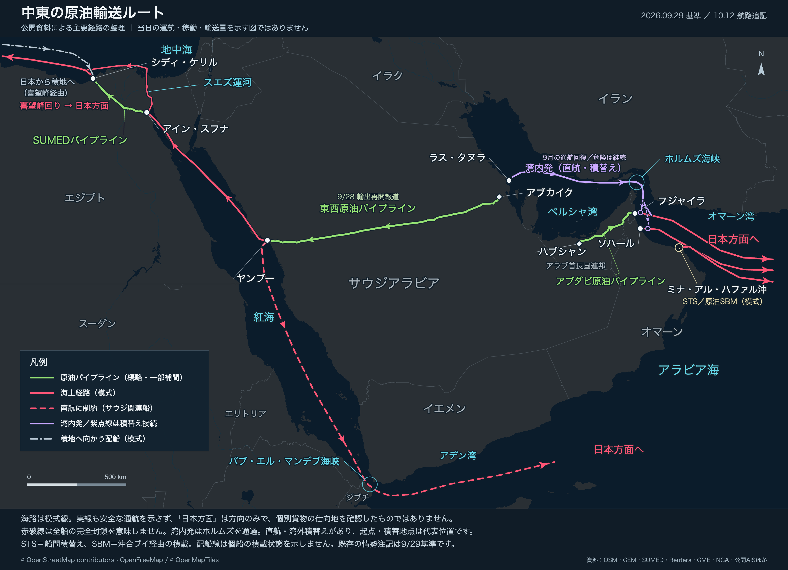
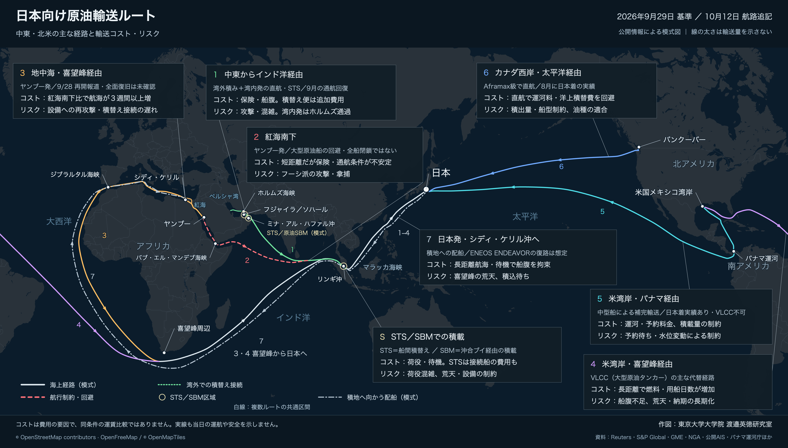

# 原油輸送ルート地図

中東の地域図と、日本向け原油輸送の全球図を作成するスクリプト・地理データ・出典資料です。公開資料とAIS由来の情報を参照した**模式航路**を、OpenStreetMap系のダーク背景に重ねます。完成画像を閲覧するほか、手元で再生成し、航路や注記を編集できます。

作図：**東京大学大学院 渡邉英徳研究室**。コードの作成・修正にはCodexを使用しています。

## 完成した地図を見る

画像を見るだけなら、実行環境の準備は不要です。下の画像から高解像度PNGを開けます。

| 中東の原油輸送ルート | 日本向け原油輸送ルート |
|---|---|
| [](examples/2026-10-12/middle-east.png) | [](examples/2026-10-12/global.png) |
| [PNG：3600 × 2608 px](examples/2026-10-12/middle-east.png) · [SVG](examples/2026-10-12/middle-east.svg) | [PNG：4800 × 2730 px](examples/2026-10-12/global.png) · [SVG](examples/2026-10-12/global.svg) |

掲載版は**中東図第8版・全球図第6版**です。日付別の完成品は [`examples/`](examples/) に保存しています。過去版は上書きせず、比較できるよう残しています。

## 情報の基準日と読み方

- **情勢・コスト評価：2026年9月29日。航路の追記：2026年10月12日。** 地図の実行や背景の更新だけでは、最新情報になりません。
- 海路は代表地点を結んだ模式線です。個船のAIS航跡、当日の運航、輸送量、安全な通航を表しません。積地へ向かう配船と、原油を積んだ日本向け輸送は区別しています。
- 費用の注記は、燃料・用船日数・荷役などの発生要因です。同条件の運賃比較や総調達費のランキングではありません。
- 対象は**原油**です。LNG・LPG・石油製品の輸送網を網羅する図ではありません。

10月12日の追記は、ミナ・アル・ハファル沖のSTS／原油SBM積載と、日本から喜望峰・ジブラルタルを経てシディ・ケリル沖へ向かう配船です。個船の確認範囲や想定は[追加記録](docs/route-additions-20261012.md)に記載しています。

## 手元で地図を再生成する

### 必要なもの

| 用途 | 必要な環境 |
|---|---|
| SVG・GeoJSONのみ生成 | Python 3.9以降（標準ライブラリのみ） |
| PNGと描画確認結果も生成 | 上記に加え、Node.js 20以降・npm・ChromeまたはPlaywrightのChromium・日本語フォント |

日本語フォントは、macOSではヒラギノ、その他の環境ではNoto Sans CJK JP等を使用します。確認済みの環境はmacOSです。OS・フォント・ブラウザーが異なると、文字幅や配置が変わる場合があります。

### 最初の実行（macOS / Linux）

```sh
git clone https://github.com/wtnv-lab/oil-transport-maps.git
cd oil-transport-maps
npm ci
npx playwright install chromium
CHROME_CHANNEL=chromium ./build.sh all
```

`dist/` に両方の地図が出力されます。最初の依存ライブラリ・ブラウザーの取得にはネット接続が必要ですが、**通常の再作図は保存済み背景を使うため、以後はオフラインで実行できます**。

macOSにGoogle Chromeがインストールされていれば自動検出します。その場合はChromiumの取得を省略し、`./build.sh all` で実行できます。Linuxでブラウザーのシステムライブラリが不足する場合は、Playwrightのエラーメッセージに従って追加してください。

Windowsでは、依存ライブラリとChromiumの取得後、PowerShell等から `py -3 scripts/build.py all` を実行します。Python・Node.jsがPATHに登録されている必要があります。Windowsでの描画結果は未検証です。

### 使う地図を選ぶ

```sh
./build.sh all           # 両方
./build.sh middle-east   # 中東図のみ
./build.sh global        # 全球図のみ
```

macOSでは `build.command` をダブルクリックすると、両図を作成して出力フォルダーを開きます。初回の `npm ci` とブラウザーの準備は先に済ませてください。

Pythonだけで試す場合は、リポジトリを取得して次を実行します。npmやブラウザーは不要です。

```sh
python3 scripts/build.py all --svg-only
```

`--svg-only` はPNGを更新せず、ブラウザーによる描画確認も行いません。すでにあるPNGは古いまま残るため、共有する前に通常のビルドを実行してください。

### 出力ファイル

| 種類 | 中東図 | 全球図 |
|---|---|---|
| 投稿・配布用画像 | `dist/middle-east.png` | `dist/global.png` |
| 背景画像を内包するSVG | `dist/middle-east.svg` | `dist/global.svg` |
| 代表座標と経路のGeoJSON | `dist/middle-east.geojson` | `dist/global.geojson` |
| 文字・引出線等の描画確認 | `dist/middle-east.qa.json` | `dist/global.qa.json` |

`dist/` は再生成用で、Gitには収録していません。同じ名前の出力は上書きされます。残したい版は別の出力先を指定できます。

```sh
./build.sh all --output-dir ./dist/review
```

GeoJSONも模式的な代表座標です。描画確認用JSONは文字の重なりなどを検出する補助で、地理や記述の正しさを検証するものではありません。

## 航路や注記を編集する

| 変更する内容 | 編集するファイル |
|---|---|
| 中東図の経路・地点・文字・配色 | [`maps/middle-east/build.py`](maps/middle-east/build.py) |
| 全球図の経路・地点・バルーン・配色 | [`maps/global/build.py`](maps/global/build.py) |
| 表題・基準日・版番号・クレジット | 各地図の `metadata.json` |
| 根拠・出典・確認できていない点 | [`docs/`](docs/) 内の対応する資料 |

1. 出典資料を確認し、対象の `build.py` を編集します。地理座標は **`[経度, 緯度]`、単位は度**です。ラベルの位置にはSVG上のピクセル座標も使います。
2. 情報の確認範囲に合わせて `metadata.json` と出典を更新します。`as_of` は情勢の基準日、`route_additions_as_of` は一部航路の追記日です。描き直した日を、そのまま情報の基準日にしないでください。
3. 対象の地図を再生成し、PNGを目視確認します。文字・線の重なり、海峡や海岸線との関係、矢印の方向、出典との整合を確認してください。

生成済みのSVGだけでなく、元のスクリプトを編集すると再現できます。具体的な作業の流れとコードの読み方は[更新・点検の手順](docs/MAINTENANCE.md)を参照してください。

## 生成の仕組みとファイル構成

```text
公開資料・代表座標 + metadata.json + 保存済みの背景PNG
  → Pythonで航路・注記をSVG化（GeoJSONも保存）
  → PlaywrightでSVGを開き、PNGと描画確認結果を出力
```

背景はMapLibre GL JSで取得したOpenStreetMap系データを、独自のダーク配色で描画したものです。地図の文字・航路はPythonで重ねるため、背景を再取得せずに編集できます。

```text
maps/
  middle-east/        中東図の作図コード・設定・背景・地理データ
  global/             全球図の作図コード・設定・背景・代表経路
scripts/
  build.py            地図を選び、SVG生成とPNG出力を順に実行
  render.cjs          SVGのPNG化と描画確認
  browser.cjs         Chrome / Chromiumの選択
  refresh-basemap.cjs 背景を再取得するコマンド
examples/             日付別の完成品
docs/                出典・注釈・編集手順
dist/                手元で生成される出力（Git対象外）
```

### 背景を更新する場合だけ

```sh
npm run refresh-basemap -- all
./build.sh all
```

`all` の代わりに `middle-east` または `global` も指定できます。この処理にはネット接続が必要で、各地図の背景PNGと投影情報 `data/base-projection.json` を更新します。背景と投影情報はセットで管理してください。背景の更新は、ニュース・通航状況・航路の更新ではありません。

### 困ったとき

| 症状 | 対処 |
|---|---|
| 依存ライブラリがない | リポジトリの直下で `npm ci` を実行 |
| ブラウザーを起動できない | `npx playwright install chromium` 後、`CHROME_CHANNEL=chromium ./build.sh all` を実行（macOS / Linux） |
| 日本語が四角になる・文字が重なる | 日本語フォントを確認。PNGと `*.qa.json` を見て必要な配置を調整 |
| Pythonやブラウザーの場所を指定したい | `PYTHON=/path/to/python3`、`CHROME_PATH=/path/to/chrome` を環境変数に指定（macOS / Linux） |
| 背景の取得に失敗する | 通常の再作図は既存の背景で可能。背景の更新が必要な場合だけ通信状態を確認 |

PlaywrightとMapLibre GL JSの依存バージョンは `package-lock.json` で固定しています。再現には `npm ci` を使ってください。

## 出典と利用条件

- [中東図の注釈・限界](docs/middle-east-sources.md)
- [中東図の地理データ・精度](docs/middle-east-geometry.md)
- [全球図の出典・コストの読み方](docs/global-sources-and-costs.md)
- [10月12日の追加航路と船舶情報](docs/route-additions-20261012.md)

地図背景の帰属表示は **© OpenStreetMap contributors · OpenFreeMap / © OpenMapTiles** です。画像に記載した帰属表示と作図クレジットを残してください。外部データの利用条件は各提供元の記載を参照してください。

このリポジトリには、コード・独自作図部分のライセンスファイルはまだ設定していません。
