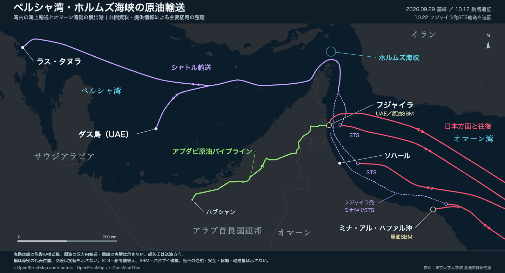

# 原油輸送ルート地図

中東の地域図と、日本向け原油輸送の全球図を作成するスクリプト・地理データ・出典資料です。公開資料とAIS由来の情報を参照した**模式航路**を、OpenStreetMap系のダーク背景に重ねます。完成画像を閲覧するほか、手元で再生成し、航路や注記を編集できます。

作図：**東京大学大学院 渡邉英徳研究室**。コードの作成・修正にはCodexを使用しています。

## リポジトリを生成AIに渡して始める

**このリポジトリを生成AIの作業対象にすると、「この航路を加える」「文字を小さくする」といった会話で地図を更新できます。** 作図に使うデータ・コード・出典をまとめて参照できる状態にして、下の依頼文を渡してください。完成画像だけを見る場合は[地図の一覧](#完成した地図を見る)へ進めます。

| AIに渡す方法 | 手順 |
|---|---|
| ローカルフォルダーを扱えるAI | リポジトリを取得し、`README.md` のある `oil-transport-maps` フォルダーを作業対象として開く |
| リポジトリの閲覧・取得に対応したAI | `https://github.com/wtnv-lab/oil-transport-maps` を渡し、配下のファイルを実際に読ませる |
| ZIPの展開・読取りに対応したAI | GitHubの「Code → Download ZIP」で取得したZIPを添付し、展開したフォルダー内を読ませる |

URLやZIPを渡しただけでは、全ファイルを読めるとは限りません。AIに読めたファイルと、編集・実行・画像確認ができるかを最初に報告してもらいます。リポジトリ全体を参照できる状態にし、必要なファイルを順に読む方法です。依存ライブラリや過去の全画像を一度に文章として読み込む必要はありません。

### 最初に送る依頼文

```text
このリポジトリを読み込み、対話しながら地図を編集できるようにしてください。
リポジトリ：https://github.com/wtnv-lab/oil-transport-maps
ローカルフォルダーまたは添付ZIPがある場合は、その内容を作業対象にしてください。

README.md → AGENTS.md → docs/AI_WORKFLOW.md の順に読み、
作業に必要なガイド、地図のコード・データ・metadata.json、出典を参照してください。
README内の「AI向けリポジトリ案内」を入口にしてください。

実際に読めたファイル、地図の種類と情報基準日、
この環境でできること（ファイル編集・コマンド実行・PNG確認・ウェブ検索）を
簡潔に示してください。読めないファイルや実行できない工程は明記してください。
まず構成を把握し、ファイルは変更せず、私の次の編集指示を待ってください。
```

続けて、たとえば次のように指示します。

> 全球図に、添付資料で確認できる積替え地点を追加してください。出典と観測日を残し、既存の地名に重ならない位置に注記を置いて、完成画像を見せてください。

> 追加した注記を2行に短くし、地名を少し右へ動かしてください。航路の座標はそのままにしてください。

具体的な指示を渡した後は、AIに編集・検査・再描画まで進めてもらい、画像を見ながら調整します。実行機能のないAIでは変更ファイルを受け取り、[手元の環境で再生成](#手元で地図を再生成する)します。

**[読み込み方・対話例・別の会話への引継ぎ](docs/AI_WORKFLOW.md)**

## 完成した地図を見る

画像を見るだけなら、実行環境の準備は不要です。下の画像から高解像度PNGを開けます。**中東図・全球図の作図更新：2026年10月12日**（情報の基準日とは別です）。

| 中東の原油輸送ルート · 第15版 | 日本向け原油輸送ルート · 第13版 |
|---|---|
| [](examples/2026-10-12-design-system/middle-east.png?v=15-20b47336428a) | [](examples/2026-10-12-design-system/global.png?v=13-cf14ff9308b2) |
| [PNG：3600 × 2608 px](examples/2026-10-12-design-system/middle-east.png?v=15-20b47336428a) · [SVG](examples/2026-10-12-design-system/middle-east.svg?v=15-1a635fe61fdb) | [PNG：4800 × 2730 px](examples/2026-10-12-design-system/global.png?v=13-cf14ff9308b2) · [SVG](examples/2026-10-12-design-system/global.svg?v=13-93d932a7ffb0) |
| [PC表示例：幅1440px](examples/2026-10-12-design-system/middle-east-pc1440.png?v=15-8f88aabec9e8) | [PC表示例：幅1440px](examples/2026-10-12-design-system/global-pc1440.png?v=13-d0177e7e3dca) |

掲載版は**中東図第15版・全球図第13版**です。国・大陸・海域名は縁なしの明朝体、主要港・パイプライン名は細い縁取りの角ゴシックで描き分け、文字の重要性と親子関係を示します。今回、書体・色・線・記号・余白を共通のデザイン設定へ整理しました。航路・地点座標・記載内容・情報基準日は変更していません。日付別の完成品は [`examples/`](examples/) に保存し、過去版も比較できるよう残しています。

**[デザインの方針と編集方法](docs/DESIGN_SYSTEM.md)** · [見本帳（HTML）](docs/design-system.html) · [見本帳（PNG）](docs/design-system.png)

### ペルシャ湾・ホルムズ海峡の拡大図

**作図更新：2026年10月22日。** ラス・タヌラ、ダス島、ムサンダム沿岸のシャトル輸送、フジャイラ・ソハール・ミナ沖のSTS／SBMを示すWeb用の拡大図です。凡例枠を省き、下部の注記を2行に整理しています。

[](examples/2026-10-22-gulf-hormuz-oman/gulf-hormuz-oman.png)

[PNG：3600 × 1948 px](examples/2026-10-22-gulf-hormuz-oman/gulf-hormuz-oman.png) · [SVG](examples/2026-10-22-gulf-hormuz-oman/gulf-hormuz-oman.svg) · [出典・編集方法・確認範囲](docs/gulf-hormuz-oman.md)

```sh
./build.sh gulf-hormuz-oman
```

`dist/gulf-hormuz-oman.*` とPC用画像を生成します。`all` は従来の中東図・全球図の2図です。拡大図は `user-data` レイヤーに未対応で、内蔵のGeoJSONを編集します。**フジャイラ発→ミナ沖STSは提供情報に基づく模式表示で、公開一次資料による独立確認は未了**です。10月22日の部分追加・作図調整を、全面的な情勢更新とは扱いません。

## 情報の基準日と読み方

- **情勢・コスト評価：2026年9月29日。航路の追記：2026年10月12日。** 地図の実行や背景の更新だけでは、最新情報になりません。
- 海路は代表地点を結んだ模式線です。往復矢印は船の配船・輸送による往復を表します。原油が両方向へ流れること、個船の往復完了、往復が同じ航路であることを確認した表示ではありません。AIS航跡、当日の運航、輸送量、安全な通航も表しません。パイプラインの矢印は原油の送油方向です。
- 費用の注記は、日本向け調達に伴う燃料・用船日数・荷役などの発生要因です。往復運賃の実額、同条件の運賃比較、総調達費のランキングではありません。
- 対象は**原油**です。LNG・LPG・石油製品の輸送網を網羅する図ではありません。

10月12日には、ミナ・アル・ハファル沖のSTS／原油SBM積載と、日本から喜望峰・ジブラルタルを経てシディ・ケリル沖へ向かう配船を追記しました。現行版ではシディ・ケリル行きも他地域と共通の往復矢印で表します。個船の確認範囲や想定は[追加記録](docs/route-additions-20261012.md)に残しています。

## 手元で地図を再生成する

### 必要なもの

| 用途 | 必要な環境 |
|---|---|
| SVG・GeoJSONのみ生成 | Python 3.9以降（標準ライブラリのみ） |
| PNGと描画確認結果も生成 | 上記に加え、Node.js 20以降・npm・ChromeまたはPlaywrightのChromium・日本語フォント |

日本語フォントは、macOSではヒラギノのゴシック体と明朝体、その他の環境ではNoto Sans CJK JP・Noto Serif CJK JP等を使用します。書体ファイルは同梱せず、利用環境にあるフォントを参照します。確認済みの環境はmacOSです。OS・フォント・ブラウザーが異なると、文字幅や配置が変わる場合があります。

### 最初の実行（macOS / Linux）

```sh
git clone https://github.com/wtnv-lab/oil-transport-maps.git
cd oil-transport-maps
npm ci
npx playwright install chromium
CHROME_CHANNEL=chromium ./build.sh all
```

`dist/` に両方の地図が出力されます。最初の依存ライブラリ・ブラウザーの取得にはネット接続が必要ですが、**通常の再作図は保存済み背景を使うため、以後はオフラインで実行できます**。

macOSにGoogle Chromeがインストールされていれば自動検出します。その場合はChromiumの取得を省略し、`./build.sh all` で実行できます。Linuxでブラウザーのシステムライブラリが不足する場合は、Playwrightのエラーメッセージに従って追加してください。

Windowsでは、依存ライブラリとChromiumの取得後、PowerShell等から `py -3 scripts/build.py all` を実行します。Python・Node.jsがPATHに登録されている必要があります。Windowsでの描画結果は未検証です。

### 使う地図を選ぶ

```sh
./build.sh all           # 両方
./build.sh middle-east   # 中東図のみ
./build.sh global        # 全球図のみ
./build.sh gulf-hormuz-oman # ホルムズ拡大図のみ
```

macOSでは `build.command` をダブルクリックすると、両図を作成して出力フォルダーを開きます。初回の `npm ci` とブラウザーの準備は先に済ませてください。

Pythonだけで試す場合は、リポジトリを取得して次を実行します。npmやブラウザーは不要です。

```sh
python3 scripts/build.py all --svg-only
```

`--svg-only` はPNGを更新せず、ブラウザーによる描画確認も行いません。すでにあるPNGは古いまま残るため、共有する前に通常のビルドを実行してください。

### 出力ファイル

| 種類 | 中東図 | 全球図 |
|---|---|---|
| 投稿・配布用画像 | `dist/middle-east.png` | `dist/global.png` |
| 背景画像を内包するSVG | `dist/middle-east.svg` | `dist/global.svg` |
| 代表座標と経路のGeoJSON | `dist/middle-east.geojson` | `dist/global.geojson` |
| 文字・引出線等の描画確認 | `dist/middle-east.qa.json` | `dist/global.qa.json` |

`dist/` は再生成用で、Gitには収録していません。同じ名前の出力は上書きされます。残したい版は別の出力先を指定できます。

```sh
./build.sh all --output-dir ./dist/review
```

GeoJSONも模式的な代表座標です。描画確認用JSONは文字の重なりなどを検出する補助で、地理や記述の正しさを検証するものではありません。

## 生成AIで独自データを追加・更新する

対象の地図、追加する港・航路・注記、根拠資料、観測日をAIに伝えます。AIが `user-data/*.geojson` を編集し、既存の図へ追加データを重ねます。出典・確認状態を記録し、追加データの更新日は図の下部に別記します。

元からある航路やバルーンの変更は、次の表の作図コードが対象です。追加レイヤーと元図の変更をAIに選び分けてもらいます。実際の資料と生成画像を照合し、未確認の位置・日付・実績を推測で補わないようにしてください。

**[追加・更新・削除の依頼文](docs/USER_DATA.md)** · [入力仕様・手動編集リファレンス](docs/USER_DATA_REFERENCE.md) · [JSON Schema](docs/user-data.schema.json)

## AI向けリポジトリ案内

### 読む順序

1. `README.md`：目的、入口、ファイルの対応、実行方法。
2. `AGENTS.md`：このリポジトリでの作業方針。
3. `docs/AI_WORKFLOW.md`：対話による編集の進め方。
4. 追加データなら `docs/USER_DATA.md` と入力仕様、元図の変更なら `docs/MAINTENANCE.md`、見た目の変更なら `docs/DESIGN_SYSTEM.md`。
5. 対象の作図コード・入力データ・`metadata.json` と、対応する出典Markdown。

地図の版番号・情報基準日は各 `metadata.json`、独自データの形式は `docs/user-data.schema.json` と検査処理を確認します。`dist/` の生成物から入力データを復元しないでください。未コミットの変更や既存の追加項目を確認してから、依頼に必要な箇所を編集します。

### 機械可読の索引

以下はファイルを探すための索引です。自動設定として読み込まれるものではありません。パスとコマンドはリポジトリ直下を基準にしています。

```yaml
project: oil-transport-maps
language: ja
repository: https://github.com/wtnv-lab/oil-transport-maps
license: CC-BY-4.0
license_file: LICENSE
license_scope: original_code_documentation_and_map_design_only
third_party_terms: README.md#第三者の素材とデータ
working_directory: repository_root
instructions: AGENTS.md
workflow: docs/AI_WORKFLOW.md
entrypoint: scripts/build.py
map_ids: [middle-east, global, gulf-hormuz-oman]
all_targets: [middle-east, global]
build_targets: [all, middle-east, global, gulf-hormuz-oman]
design:
  guide: docs/DESIGN_SYSTEM.md
  foundations: design/foundations.json
  profiles: design/profiles/{map_id}.json
  loader: scripts/design_system.py
  specimen: docs/design-system.html
input_schema: docs/user-data.schema.json
default_output_directory: dist
maps:
  middle-east:
    builder: maps/middle-east/build.py
    metadata: maps/middle-east/metadata.json
    user_data: user-data/middle-east.geojson
    sources: docs/middle-east-sources.md
  global:
    builder: maps/global/build.py
    metadata: maps/global/metadata.json
    user_data: user-data/global.geojson
    sources: docs/global-sources-and-costs.md
  gulf-hormuz-oman:
    builder: maps/gulf-hormuz-oman/build.py
    metadata: maps/gulf-hormuz-oman/metadata.json
    routes: maps/gulf-hormuz-oman/data/zoom-routes.geojson
    design_profile: design/profiles/middle-east.json
    user_data: unsupported
    sources: docs/gulf-hormuz-oman.md
additional_sources: docs/route-additions-20261012.md
commands:
  validate_data: python3 scripts/build.py all --check-data
  check_design: python3 scripts/check_design.py
  build_design_guide: python3 scripts/build_design_guide.py
  render_design_guide: node scripts/preview.cjs docs/design-system.html docs/design-system.png --selector "#specimen"
  render: python3 scripts/build.py all
  svg_only: python3 scripts/build.py all --svg-only
  desktop_preview: node scripts/preview.cjs dist/global.svg dist/global-pc1440.png
  user_layer_tests: python3 -m unittest discover -s tests -v
outputs: ["{map_id}.png", "{map_id}.svg", "{map_id}.geojson", "{map_id}.qa.json"]
```

### 元の航路や注記を編集する

独自データは元図に重ねる追加レイヤーです。既存の航路やバルーンの上書きには、以下の作図コードを編集します。

| 変更する内容 | 編集するファイル |
|---|---|
| 独自の港・航路・注記を追加、更新、削除 | `user-data/global.geojson` / `user-data/middle-east.geojson` |
| 中東図の経路・地点・記載内容・ラベル位置 | [`maps/middle-east/build.py`](maps/middle-east/build.py) |
| ホルムズ拡大図の座標・記載内容・配置 | [`maps/gulf-hormuz-oman/`](maps/gulf-hormuz-oman/) と[専用ガイド](docs/gulf-hormuz-oman.md) |
| 全球図の経路・地点・記載内容・バルーン位置 | [`maps/global/build.py`](maps/global/build.py) |
| 共通の書体・基本色・余白・縁取り・追加データの既定意匠 | [`design/foundations.json`](design/foundations.json) |
| 図ごとの文字階層・地名別サイズ差・航路色・線・記号 | [`design/profiles/`](design/profiles/) 内の対象図のJSON |
| 表題・基準日・版番号・クレジット | 各地図の `metadata.json` |
| 根拠・出典・確認できていない点 | [`docs/`](docs/) 内の対応する資料 |

見た目の設定では、共通色への `"{colors.loading}"` 等の参照を維持します。中東図の国・海域名の局所的なサイズ差は `geographic_size_offsets` で管理します。[設定の説明](docs/DESIGN_SYSTEM.md)を参照してください。

1. 出典資料を確認し、対象の `build.py` を編集します。地理座標は **`[経度, 緯度]`、単位は度**です。ラベルの位置にはSVG上のピクセル座標も使います。
2. 情報の確認範囲に合わせて `metadata.json` と出典を更新します。`as_of` は情勢の基準日、`route_additions_as_of` は一部航路の追記日です。描き直した日を、そのまま情報の基準日にしないでください。
3. 対象の地図を再生成し、PNGを目視確認します。文字・線の重なり、海峡や海岸線との関係、矢印の方向、出典との整合を確認してください。

生成済みのSVGだけでなく、元のスクリプトを編集すると再現できます。具体的な作業の流れとコードの読み方は[更新・点検の手順](docs/MAINTENANCE.md)を参照してください。

### 変更後の確認と受け渡し

| 変更内容 | 必要な確認 |
|---|---|
| 一方の地図のコード・データ | 対象の入力検査と通常ビルド。PNGと描画確認結果を確認 |
| 両図に共通する描画処理 | `./build.sh all` で両方を描画・確認 |
| デザイン設定 | `python3 scripts/check_design.py`、見本帳と両図の再生成、1440px幅での確認。[詳細](docs/DESIGN_SYSTEM.md) |
| 独自データの検査・描画機能 | 上記に加え、`python3 -m unittest discover -s tests -v` とサンプルの描画 |
| 説明文のみ | 記載したパス・リンク・コマンドと実装の整合を確認 |

サンプルの描画コマンドは `./build.sh all --data-dir examples/user-data --output-dir dist/tutorial` です。サンプルは架空のデータです。

AIは変更したファイル、出典・観測日、未確認事項、実施した検査と実行できなかった工程を報告し、生成したPNGを利用者に示します。形式検査や描画確認は事実確認の代わりにはなりません。過去の完成品を残し、必要に応じて新しい出力先へ保存します。公開・プッシュは依頼された場合に行います。

## 生成の仕組みとファイル構成

```text
公開資料・代表座標 + metadata.json + デザイン設定 + 保存済みの背景PNG + 独自GeoJSON
  → Pythonで航路・注記をSVG化（GeoJSONも保存）
  → PlaywrightでSVGを開き、PNGと描画確認結果を出力
```

背景はMapLibre GL JSで取得したOpenStreetMap系データを、独自のダーク配色で描画したものです。地図の文字・航路はPythonで重ねるため、背景を再取得せずに編集できます。

```text
design/
  foundations.json    共通の書体・基本色・余白・表示設定
  profiles/           中東図・全球図の文字階層・線・記号
maps/
  middle-east/        中東図の作図コード・設定・背景・地理データ
  global/             全球図の作図コード・設定・背景・代表経路
scripts/
  build.py            地図を選び、SVG生成とPNG出力を順に実行
  render.cjs          SVGのPNG化と描画確認
  browser.cjs         Chrome / Chromiumの選択
  design_system.py    デザイン設定の読込みと共通SVGスタイル
  build_design_guide.py 見本帳の生成
  check_design.py     トークンとコントラストの点検
  preview.cjs         PC幅での表示確認用画像
  refresh-basemap.cjs 背景を再取得するコマンド
  user_layers.py      独自GeoJSONの形式確認と描画
user-data/            利用者が追加するデータ（初期状態は空）
examples/             日付別の完成品と、user-data/ の描画サンプル
docs/                出典・注釈・編集手順（AI_WORKFLOW.mdが対話編集の入口）
tests/               独自データの検査・再生成を確認するテスト
dist/                手元で生成される出力（Git対象外）
```

### 背景を更新する場合だけ

```sh
npm run refresh-basemap -- all
./build.sh all
```

`all` の代わりに `middle-east` または `global` も指定できます。この処理にはネット接続が必要で、各地図の背景PNGと投影情報 `data/base-projection.json` を更新します。背景と投影情報はセットで管理してください。背景の更新は、ニュース・通航状況・航路の更新ではありません。

### 困ったとき

| 症状 | 対処 |
|---|---|
| 依存ライブラリがない | リポジトリの直下で `npm ci` を実行 |
| ブラウザーを起動できない | `npx playwright install chromium` 後、`CHROME_CHANNEL=chromium ./build.sh all` を実行（macOS / Linux） |
| 日本語が四角になる・文字が重なる | 日本語フォントを確認。PNGと `*.qa.json` を見て必要な配置を調整 |
| Pythonやブラウザーの場所を指定したい | `PYTHON=/path/to/python3`、`CHROME_PATH=/path/to/chrome` を環境変数に指定（macOS / Linux） |
| 背景の取得に失敗する | 通常の再作図は既存の背景で可能。背景の更新が必要な場合だけ通信状態を確認 |
| 独自データの形式エラー | エラーに示されたファイル・項目を修正し、`--check-data` で再確認 |
| 追加ラベルや注記が重なる | `label.offset` / `callout.offset` を調整し、PNGと `*.qa.json` を確認 |

PlaywrightとMapLibre GL JSの依存バージョンは `package-lock.json` で固定しています。再現には `npm ci` を使ってください。

## 出典と利用条件

- [中東図の注釈・限界](docs/middle-east-sources.md)
- [中東図の地理データ・精度](docs/middle-east-geometry.md)
- [全球図の出典・コストの読み方](docs/global-sources-and-costs.md)
- [10月12日の追加航路と船舶情報](docs/route-additions-20261012.md)

### ライセンス：CC BY 4.0

本リポジトリで独自に作成したコード・説明文・作図部分は、**[Creative Commons 表示 4.0 国際（CC BY 4.0）](https://creativecommons.org/licenses/by/4.0/deed.ja)** で提供します。著作者が許諾できる権利の範囲に適用し、第三者の素材・データは下記のとおり別扱いです。正式な条文は [`LICENSE`](LICENSE) に収録しています。

出典・作成者・ライセンスを表示し、変更した場合はその旨を明記することで、商用を含む再配布・改変ができます。利用する媒体に応じた合理的な方法で表示してください。改変版の表示例：

> 原図・コード：東京大学大学院 渡邉英徳研究室「原油輸送ルート地図」／[リポジトリ](https://github.com/wtnv-lab/oil-transport-maps)／[CC BY 4.0](https://creativecommons.org/licenses/by/4.0/)。変更：航路・注記を追加。

### 第三者の素材とデータ

CC BY 4.0の指定は、第三者の権利や利用条件を変更するものではありません。

- **背景地図・スタイル：** © [OpenStreetMap contributors](https://www.openstreetmap.org/copyright) · [OpenFreeMap](https://openfreemap.org/) / © [OpenMapTiles](https://openmaptiles.org/)。地図に記載した帰属表示を維持し、各提供元の条件に従ってください。
- **外部由来の地理データ：** OSM・GEM等から取得・加工したGeoJSONや経路データは、元データのライセンス・利用条件に従います。出典と加工内容は[地理データの記録](docs/pipeline-geodata-notes.md)などに記載しています。
- **依存ライブラリ・引用資料：** 各ライブラリや資料のライセンス・利用条件が適用されます。

完成したPNG・SVG・GeoJSONにも、独自部分と第三者由来の部分が含まれます。配布時は、独自部分のCC BY表示に加え、含まれる第三者素材の帰属表示・利用条件も保持してください。
