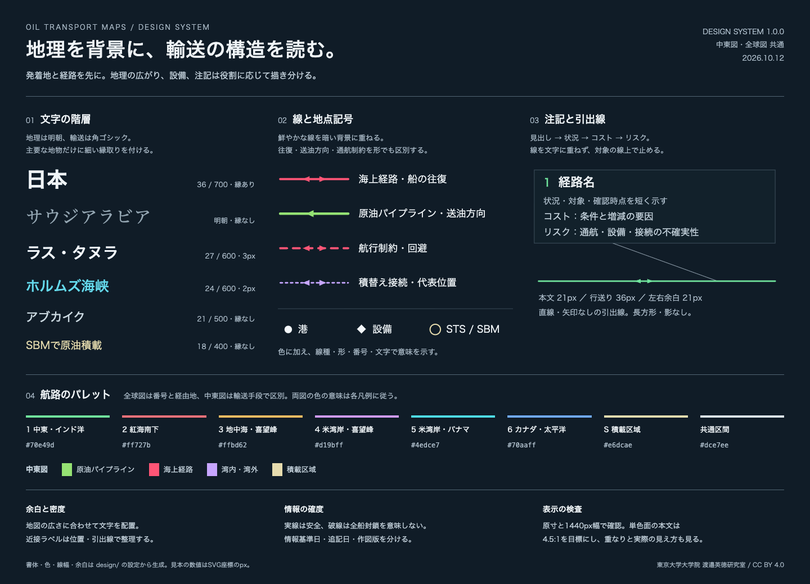

# 地図のデザインシステム

この地図では、航路の比較、積出地と到着地のつながり、設備・荷役の補足を順に読めるように、書体、色、線、記号、余白を共通の設定で管理します。**地理座標と記述は作図コード・データに、見た目のルールは `design/` に保存**します。生成AIで整える場合も、同じ設定から両図を再生成できます。

[見本帳を開く（HTML）](design-system.html) · [見本帳を見る（PNG）](design-system.png) · [再生成・点検手順](MAINTENANCE.md)



## 1. 読む順序をつくる

この地図で先に伝えるのは輸送の関係です。全球図では日本と主要な発着港を先に読み、その次に海峡・運河などの通過点、最後に積替え方式などの補足を読みます。中東図では港と幹線パイプラインを主役にし、内陸設備や荷役説明を一段小さくします。

国・大陸・広い海域は地理的な親として大きく配置しますが、明朝体と落ち着いた色で背景の文脈として扱います。「大きい文字はすべて重要」という一つの序列ではなく、書体と太さも使って地理の広がりと輸送の拠点を区別します。

バルーンは見出し、状況、コスト・リスクの本文の順に読みます。背景や注記が航路より強くなりすぎないようにし、補足を増やす前に文を短くできるか検討します。これは、優先順位、読みやすさ、簡潔さ、一貫性を重視する[Ordnance Surveyの地図設計原則](https://github.com/OrdnanceSurvey/GeoDataViz-Toolkit/blob/master/Cartographic%20Design%20Principles/README.md)を参考に、この図の目的へ適用した方針です。

## 2. 設定ファイルと役割

設定値を「トークン」と呼びます。同じ用途の値を名前で参照するため、地図ごとのコードを探して同じ値を何度も変更する必要を減らせます。

| ファイル | 管理するもの |
|---|---|
| [`design/foundations.json`](../design/foundations.json) | 共通の書体候補、基本色、縁取り、バルーンの行送りと余白、PC確認サイズなど |
| [`design/profiles/middle-east.json`](../design/profiles/middle-east.json) | 中東図の文字役割、航路・パイプライン、線・地点記号など |
| [`design/profiles/global.json`](../design/profiles/global.json) | 全球図の文字役割、ルート別の色、線・地点記号など |
| [`scripts/design_system.py`](../scripts/design_system.py) | 共通設定と各図の設定を読み込み、SVG用の共通スタイルを組み立てる処理 |
| [`maps/middle-east/build.py`](../maps/middle-east/build.py) / [`maps/global/build.py`](../maps/global/build.py) | 航路・地点の座標、記載内容、ラベルやバルーンの配置 |

**具体的な数値の正本はJSONです。** この説明書や見本帳の画像だけを書き換えず、JSONを編集して見本帳と地図を再生成します。両図に同じ意味の文字役割があっても、画面の密度や縮尺に応じてサイズは異なります。

共有色・書体を変える場合は `foundations.json`、一方の図の文字階層や航路記号を変える場合は対応する `profiles/*.json` を先に確認します。地点を指す引出線の位置や文言は、対象図の `build.py` を編集します。独自データの省略時の意匠は `foundations.json` の `user_layer` で管理し、共通の書体・パネル色・文字色も引き継ぎます。GeoJSONで明示した色・線幅・文字サイズはその指定を優先します。個別指定は[追加データの入力仕様](USER_DATA_REFERENCE.md)に従います。

### 共通色への参照と、地名ごとのサイズ差

同じ意味の色を複数の場所で使う場合は、値を転記せず `"{colors.water}"` や `"{colors.loading}"` と記述して参照します。中東図の `routes.water`・`routes.loading`、全球図の `routes.S` がその例です。`load_design()` が参照先の色へ解決するため、共通色を変えると対応する表示も一緒に変わります。参照を無関係な色値へ置き換える前に、他の図と共有する意味を確認してください。

中東図の国・海域名には、面積や文字数に合わせた局所的なサイズ差があります。`typography.country`・`typography.sea` が基準で、地名ごとの差は同じプロファイルの `geographic_size_offsets` に保存します。たとえばサウジアラビアは国名の基準サイズに4pxを加えます。基準値と差の両方をJSONで管理するため、国名全体の階層を変えながら、狭い地域での調整も維持できます。局所サイズを作図コードへ直接埋め込まず、文字位置の変更と区別して編集してください。


## 3. 文字・色・線・記号

### 文字の役割

| 対象 | 書体と強さ | 縁取りの扱い |
|---|---|---|
| 全球図の日本 | 角ゴシック・最も強い文字役割 | 暗色の細縁 |
| 主要港・積載区域 | 角ゴシック・太字 | 暗色の細縁 |
| 幹線名・海峡・運河・通過点 | 角ゴシック・中程度の強さ | 主要港より細い縁 |
| 内陸設備・荷役の補足 | 一段小さい角ゴシック | 原則なし |
| 国・大陸・海域名 | 明朝体・細め、控えめな色 | なし |
| バルーン | 大きい見出し、小さい状況、読みやすい本文 | なし |

書体の候補と参照順は `fonts`、縁の太さは `halo` で管理します。フォントファイルは同梱しません。代替書体になると字幅が変わるため、環境を変えたらPNGで確認します。すべての文字に縁を付けず、地形・航路との分離が必要なラベルだけに使います。「紅海」「ペルシャ湾」など海域名は水平のまま描きます。

### 色と線種を組み合わせる

背景にはOSM系の暗い地図を使います。主要な文字は明るく、地理の背景ラベルや状況説明は控えめにします。航路は既存の鮮やかな配色を保持し、無断で淡くしません。

色だけで情報を伝えないよう、全球図では航路とバルーンの番号・名称を対応させ、航行制約や積替え接続には線種も使います。地域図でも凡例、線種、ラベル、記号を併用します。これは[WCAGの色の使用に関する考え方](https://www.w3.org/WAI/WCAG22/Understanding/use-of-color.html)を参考にしています。色覚の違いや白黒表示で、すべての線を完全に識別できることまで保証するものではありません。

| 表現 | 読む意味・維持する条件 |
|---|---|
| 海上航路 | 地理に沿う滑らかな模式線。線の太さは輸送量を示さない |
| 同じ海路上の逆向き矢印 | 船の往復の模式表現。原油の双方向輸送や往復実績の確認ではない |
| パイプラインの矢印 | 原油の送油方向。海路の往復表示と区別する |
| 破線・点線 | 凡例に記載した航行制約・回避、積替え接続等。実線も安全や稼働を保証しない |
| 港・設備のマーカー | 代表地点。地図ごとの丸・菱形等を凡例と対応させる |
| STS／SBMのリング | 積替え・積載区域の代表位置。個別の船やブイの精密な座標ではない |

NGLラインとその凡例は再追加しません。航路を滑らかにしても、沿岸や海峡を越えて陸地へ膨らませないよう目視で確認します。

### 引出線は対応関係を明瞭にする

引出線は航路より細い直線です。地名の文字に合わせて線をつなぐ側を選び、文字とマーカーの手前で止めます。文字サイズを変えたら、線の終点も確認します。航路・地点を指す線に不要な矢印頭を付けません。

地名の引出線とバルーンの引出線は配置の自動検査対象ですが、「近くの別の点を指しているように見える」といった問題はPNGで確かめます。自動検査に通るだけで、適切な対応になったとは扱いません。

## 4. バルーンと余白

全球図のバルーンは長方形、影なし、直線の引出線です。見出し・状況・本文をまとめた一つの枠として扱い、余白は `callout` の値を使います。本文の行送りは現在36pxです。末行の下だけに大きな余白を置かず、上下のまとまりを保ちます。

文字と引出線の間隔や外枠からの距離は `spacing` にまとめます。ただし、地理上の位置を格子に丸めたり、一定の余白を作るために港や航路の座標を動かしたりしません。密集した箇所は文の短縮、改行、ラベル位置の調整を優先します。説明が増える場合は出典Markdownへ詳細を分け、図には誤解を防ぐ最小限の留保を残します。

## 5. 出典・基準日・帰属表示

見た目の変更だけでは情報を再検証したことになりません。情勢・費用の基準日 `as_of` と、一部の航路を追加した日 `route_additions_as_of` を分けます。現行図は**2026年9月29日基準、10月12日に航路追記**です。

地図の版番号は変更内容に応じて進めても、再作図した日を情報基準日に置き換えません。図に残す留保、作図クレジット「東京大学大学院 渡邉英徳研究室」、背景地図の帰属表示を維持します。コードと独自作図部分のライセンス、外部の地理データの条件は[READMEの利用条件](../README.md#出典と利用条件)を参照してください。

## 6. PC表示で確認する

トークンの検査、見本帳の再生成、両図の再描画を順に行います。

```sh
python3 scripts/check_design.py
python3 scripts/build_design_guide.py
node scripts/preview.cjs docs/design-system.html docs/design-system.png --selector '#specimen'
./build.sh all
node scripts/preview.cjs dist/middle-east.svg dist/middle-east-pc1440.png
node scripts/preview.cjs dist/global.svg dist/global-pc1440.png
```

`build_design_guide.py` はHTMLを、続く `preview.cjs` は見本帳のPNGを更新します。`preview.cjs` の `--width 1440` で確認幅を明示することもできます。トークン検査の結果を残す場合は `python3 scripts/check_design.py --output dist/design-check.json` を実行します。

PC用の基準幅は `preview.desktop_width` の1440pxです。通常のPNG出力はSVGの2倍解像度ですが、文字のpx値はSVG上の値として管理します。高解像度画像を等倍で見る確認に加え、1440px幅で次を確認します。

- 主要な発着地、通過点、荷役の補足を読み分けられるか。
- 国・大陸・海域名が背景の文脈として読め、航路より強くなりすぎていないか。
- 小さい本文も読め、見出し・状況・本文のまとまりが自然か。
- 文字・引出線・航路が重ならず、線の終点が正しい対象に対応するか。
- フォントの置換で文字幅が変わっていないか。
- 凡例、日付、留保、クレジットが欠けていないか。

`check_design.py` は設定値と文字色のコントラストを点検します。コントラストの目安には[WCAGの通常文字4.5:1・大きな文字3:1](https://www.w3.org/WAI/WCAG22/Understanding/contrast-minimum.html)を参考にします。これは一定の背景色との組み合わせを点検するもので、背景地図の全画素、すべての縮小表示、地図全体のWCAG適合を認証する検査ではありません。

`*.qa.json` は文字と引出線の干渉、および後から描かれた注記枠が既存ラベルを隠していないかを確認する補助です。デザインの検査は、位置精度、航路の妥当性、通航状況、記述の事実性を保証しません。内容を変えたときは、対応する出典も確認します。

## 7. 生成AIに変更を依頼する

```text
README.md、AGENTS.md、docs/DESIGN_SYSTEM.mdを読んでください。
design/foundations.jsonと対象図のdesign/profiles/*.jsonを確認し、
［変更したい対象と読みやすさの課題］を調整してください。

共通の書体・色・余白は共有トークン、図ごとの文字階層はプロファイルを編集し、
共通色への参照と、地名別のgeographic_size_offsetsを維持してください。
ラベル位置の調整が必要な場合だけ対象図のbuild.pyも編集してください。
航路・地点座標、記載内容、情報基準日は維持してください。
既存の鮮やかな航路色、水平な海域名、長方形の枠、直線の引出線、
本文の行送り、作図と背景の帰属表示を守ってください。

トークン検査、見本帳の再生成、両図の描画とPC幅での確認を行い、
変更ファイルと確認結果、実行できなかった工程を示してください。
完成PNGを提示し、公開・pushは依頼があるまで行わないでください。
```

トークンの意味そのものを変えるときは、この説明と見本帳も更新します。既存にない役割を追加する場合は、設定を増やすだけでなく作図コードが実際に参照することを確認してください。

## 参考資料

- [Ordnance Survey GeoDataViz Toolkit — Cartographic Design Principles](https://github.com/OrdnanceSurvey/GeoDataViz-Toolkit/blob/master/Cartographic%20Design%20Principles/README.md)：地図の優先順位・読みやすさ・簡潔さ・一貫性。
- [W3C WAI — Use of Color](https://www.w3.org/WAI/WCAG22/Understanding/use-of-color.html)：色以外の手掛かりを併用する考え方。
- [W3C WAI — Contrast (Minimum)](https://www.w3.org/WAI/WCAG22/Understanding/contrast-minimum.html)：文字と背景のコントラストの参考値と適用条件。

上記は一般的な設計・アクセシビリティの参考資料です。石油輸送に関する根拠は、[中東図の出典](middle-east-sources.md)・[全球図の出典](global-sources-and-costs.md)・[航路の追加記録](route-additions-20261012.md)に分けて保存しています。
